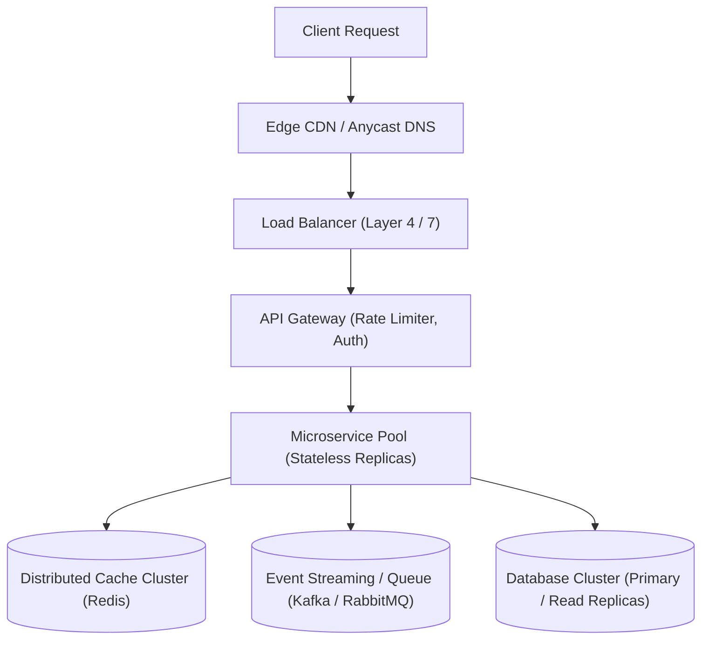

<div align="center">

# 🏛️ System Design Tutorials

### Interactive visual learning platform and handbook for mastering distributed systems, high availability, and scalability

[](https://system-design-tutorials.vercel.app)
[](https://react.dev/)
[](https://www.typescriptlang.org/)
[](https://vitejs.dev/)
[](https://tailwindcss.com/)
[](LICENSE)

[Overview](#-overview) •
[Interactive Case Studies](#-28-interactive-case-studies) •
[Tech Stack](#-tech-stack) •
[Quick Start](#-quick-start) •
[Author](#-author) •
[License](#-license)

</div>

---

## 📌 Overview

**System Design Tutorials** is an interactive, visual learning platform and handbook designed to master **System Design**, **Distributed Systems**, and **High-Scalability Architectural Patterns**. It combines deep-dive foundational blueprints with 28+ real-world interactive case studies featuring animated request-flow visualizers, bottleneck analyzers, and dynamic capacity estimators.

🔗 **Live Platform**: [https://system-design-tutorials.vercel.app](https://system-design-tutorials.vercel.app)

### Key Highlights
- 📚 **Core Building Blocks**: Deep dives into Load Balancing, Consistent Hashing, Distributed Caching (Redis/Memcached), Message Brokers (Kafka/RabbitMQ), Database Sharding & Replication, and Consensus (Raft/Paxos).
- 🔬 **28+ Interactive Case Studies**: Real-world architectures for URL Shorteners (Bitly), Rate Limiters, Distributed Cache, Real-time Chat (WhatsApp/Slack), Video Streaming (YouTube/Netflix), and E-Commerce Checkout.
- ⚡ **Animated Request Tracing**: Interactive step-by-step visual request tracing covering edge-to-service, cache hits/misses, and multi-region database replication.
- 🧮 **Back-of-the-Envelope Estimator**: Real-time calculators for QPS, bandwidth, read/write ratios, and 5-year storage projections.
- 🤖 **AI Architectural Advisor**: Integrated Gemini AI advisor evaluating architectural trade-offs, scalability bottlenecks, and design questions.

---

## 🏛 Architecture



> [!NOTE]
> Each case study provides interactive controls to toggle component failures, trace latency hot-spots, and view back-of-the-envelope resource requirements.

---

## 🔬 28+ Interactive Case Studies

| Category | Real-World Systems Modeled |
| :--- | :--- |
| **High-Throughput Utilities** | URL Shortener (Bitly), Distributed Unique ID Generator (Snowflake), Distributed Rate Limiter |
| **Data & Storage** | Distributed Key-Value Store (Dynamo/Cassandra), Distributed Cache (Redis), Web Crawler |
| **Streaming & Media** | Video Streaming Platform (YouTube/Netflix), Music Streaming (Spotify), Live Video Streaming |
| **Real-Time Communication** | Real-Time Chat System (WhatsApp), Collaborative Document Editor (Google Docs) |
| **Commerce & Financials** | E-Commerce Flash Sale Checkout, Distributed Payment Gateway, Digital Wallet |
| **Social & Search** | Social Media News Feed (Twitter/X), Typeahead Search Autocomplete, Nearby Places (Yelp) |

---

## 🛠 Tech Stack

| Domain | Technologies |
| :--- | :--- |
| **Frontend Framework** | React 19, Vite 6 |
| **Language & Tooling** | TypeScript 5.8, ESLint |
| **Styling & UI** | Tailwind CSS v4, Motion (Framer Motion), Lucide Icons |
| **AI Integration** | Google Gen AI SDK (`@google/genai`) |
| **Deployment** | Vercel (Edge Network) |

---

## 📂 Repository Layout

```text
├── src/                  # Application source code
│   ├── components/       # Visualizers, architecture diagrams, flow animated canvases
│   ├── data/             # Case studies data, architectural blueprints, trade-off matrices
│   ├── hooks/            # Dynamic calculation hooks (capacity estimator, QPS math)
│   └── lib/              # Gemini AI client and utilities
├── public/               # Static diagrams and SVG assets
└── vite.config.ts        # Vite configuration and build optimizations
```

---

## 🚀 Quick Start

### Prerequisites
- Node.js 20+
- npm or pnpm

### 1. Clone & Install
```bash
git clone https://github.com/akazad13/system-design-tutorials.git
cd system-design-tutorials
npm install
```

### 2. Start Development Server
```bash
npm run dev
```
Open [http://localhost:3000](http://localhost:3000) to launch the interactive handbook.

### 3. Build for Production
```bash
npm run build
npm run preview
```

---

## 🤖 AI-Driven Development & Contributing

Autonomous coding agents (Antigravity, Cursor, Claude Code, GitHub Copilot) operating in this repository must consult [AGENTS.md](AGENTS.md) for case study data contracts (`src/data/`), Gemini client patterns (`src/lib/`), and TypeScript validation standards.

---

## 👤 Author

**Md. Abul Kalam**
- GitHub: [@akazad13](https://github.com/akazad13)
- LinkedIn: [Md. Abul Kalam](https://linkedin.com/in/akazad13)

---

## 📄 License

This project is licensed under the [MIT License](LICENSE).